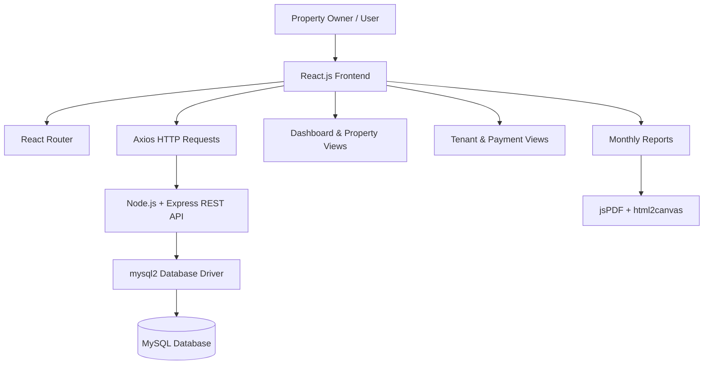
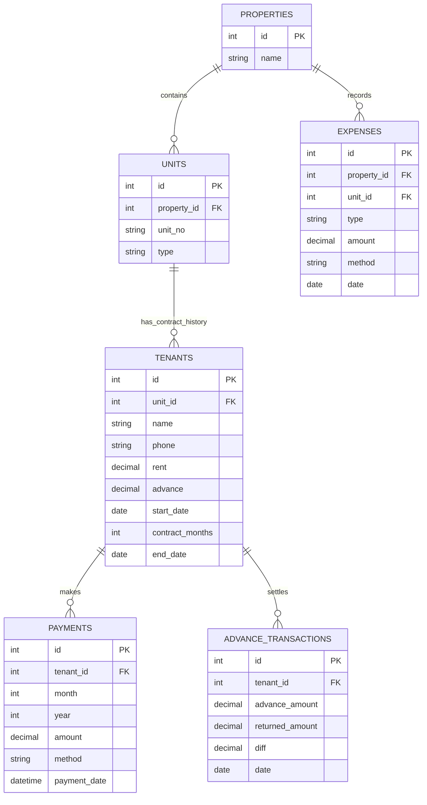

<div align="center">

# 🏠 Rental Management System

### A Full-Stack Web Application for Smarter Property Management

Manage properties, tenants, rent payments, expenses, contracts, and financial reports — all in one place.

<br/>


<br/>

[Features](#-features) · [Architecture](#-system-architecture) · [Database](#-database-design) · [Getting Started](#-getting-started) · [API](#-api-overview)

</div>

---

## 📌 Overview

The **Rental Management System** is a full-stack application designed to simplify day-to-day rental operations for property owners. It brings property and unit records, tenant contracts, monthly rent collection, expenses, advance settlements, and financial reporting into a centralized interface.

The dashboard summarizes income, expenses, and profit, while property-level views help track occupancy, payment status, pending rent, and contract duration.

> 🎯 **Project goal:** Reduce manual rental record-keeping and make property finances easier to monitor.

## ✨ Features

### 📊 Dashboard & Financial Overview
- View total and current-month income, expenses, and profit.
- See financial summaries across managed properties.
- Navigate from the dashboard to individual property views.
- Include advance-settlement differences in overall financial totals.

### 🏢 Property & Unit Management
- Add and manage multiple properties.
- Add units under a property, including **flats** and **shops**.
- View each unit's tenant, rent, payment status, pending months, and contract duration.
- Track vacant units separately from occupied units.

### 👥 Tenant & Contract Management
- Register tenant details, rent, advance amount, start date, and contract duration.
- Edit tenant information when details change.
- End a tenant contract with a recorded end date.
- Calculate the remaining contract duration and highlight contracts with three months or less remaining.

### 💳 Rent Payment Tracking
- Record rent payments against a specific month and year.
- Record the payment date and payment method.
- Generate a month-by-month **Paid / Unpaid** history from the tenant's start month through the current month.
- Identify pending rent periods in the property view.

### 🧾 Expenses & Advance Settlements
- Record property expenses with type, amount, date, and payment method.
- Review expense records by property.
- Record tenant advance settlement details, including the original advance, returned amount, difference, and settlement date.
- Reflect positive or negative settlement differences in overall income or expense totals.

### 📅 Monthly Reports
- Filter reports by a start month and end month.
- Review monthly income, expenses, and net profit.
- View property-wise financial totals.
- Inspect rent details, payment status, payment method, and payment date.
- Review expense details.
- Export reports as **PDF** or print them.

### 🔐 Login
- Provide a login screen for the application.
- Validate submitted credentials against the configured users table.

---

## 🧰 Tech Stack

| Layer | Technologies | Purpose |
|---|---|---|
| Frontend | React.js, JavaScript, HTML, CSS | Component-based user interface |
| UI & Layout | Bootstrap | Responsive layout, cards, forms, and tables |
| Routing | React Router | Navigation between login, dashboard, property, unit, and report pages |
| HTTP Client | Axios | Requests from the frontend to the backend API |
| Backend | Node.js, Express.js | REST-style API endpoints and application logic |
| Database Driver | `mysql2` | Connect the Node.js backend to MySQL |
| Database | MySQL | Store properties, units, tenants, payments, expenses, users, and advance transactions |
| Report Export | `jsPDF`, `html2canvas` | Generate PDF reports from report content |
| Development | Nodemon | Restart the backend during development |
| Testing Setup | Jest / React Testing Library | Frontend test infrastructure included in the project |

---

## 🏗️ System Architecture

The application follows a **client–server architecture**. The React frontend sends HTTP requests through Axios to the Express API. The backend runs SQL queries through `mysql2`, and MySQL stores the application's records.



### 🔄 Typical Request Flow

1. A user opens a page, such as the dashboard or a property.
2. React renders the relevant screen and Axios requests the required data.
3. Express receives the request and executes the corresponding SQL query.
4. MySQL returns the matching records.
5. The API responds with data, and React updates the interface.
6. For monthly reports, the frontend organizes the returned data and supports PDF export or printing.

---

## 🗃️ Database Design

The backend connects to a MySQL database named `rental_app`. The application code references the following tables:

| Table | Responsibility |
|---|---|
| `users` | Login credentials used by the login endpoint |
| `properties` | Property records |
| `units` | Flats or shops associated with a property |
| `tenants` | Tenant details, rent, advance, start date, contract duration, and end date |
| `payments` | Rent payments associated with tenants and a month/year |
| `expenses` | Property expenses, payment method, date, and notes |
| `advance_transactions` | Advance settlement amounts, differences, and dates |

### 🔗 Relationship Overview



*Note: This diagram summarizes the relationships implied by the application queries. Confirm column types and foreign-key constraints against your actual MySQL schema before treating it as the final database specification.*

---

## 🖥️ Application Pages

| Page | What it does |
|---|---|
| 🔐 Login | Accepts a username and password and checks them through the backend |
| 📊 Dashboard | Displays overall/current financial KPIs and the property list |
| 🏢 Property Details | Shows property KPIs, units, occupancy/payment indicators, contract duration, and expenses |
| 👤 Unit / Tenant | Adds or edits tenant details, records rent, displays payment history, and ends contracts |
| 📅 Monthly Report | Filters a month range, shows monthly and property-wise summaries, and supports PDF export/printing |


## 🚀 Getting Started

Follow these steps to run the project locally.

### ✅ Prerequisites

Install the following:

- [Node.js and npm](https://nodejs.org/)
- [MySQL Server](https://dev.mysql.com/downloads/mysql/)
- [Git](https://git-scm.com/)

### 1️⃣ Clone the Repository

```bash
git clone <YOUR_GITHUB_REPOSITORY_URL>
cd <YOUR_PROJECT_FOLDER>
```

### 2️⃣ Configure the Database

1. Start your MySQL server.
2. Create a database named `rental_app`.
3. Create the tables used by the application: `users`, `properties`, `units`, `tenants`, `payments`, `expenses`, and `advance_transactions`.
4. Configure the database connection in `db.js`.
5. Add a user record to the `users` table for testing the login flow.

> ⚠️ The project files reference the `rental_app` database, but a complete SQL schema/seed script was not included in the files reviewed. Add your schema script to the repository so others can reproduce the database setup.

### 3️⃣ Configure the Backend

Open a terminal in the backend directory — the directory containing the backend `package.json` — and install dependencies:

```bash
npm install
```

Review `db.js` and configure the MySQL connection for your own environment. **Do not commit real passwords or other secrets.** Prefer environment variables for database credentials.

Start the backend:

```bash
node server.js
```

The API listens on **port `5000`**. If you use Nodemon during development, you can run:

```bash
npx nodemon server.js
```

### 4️⃣ Configure the Frontend

Open a separate terminal in the frontend directory — the directory containing the React `package.json` — and install dependencies:

```bash
npm install
```

Start the React development server:

```bash
npm start
```

The frontend code currently sends API requests to `http://localhost:5000`. If you change the backend host or port, update the API base URL in the frontend or centralize it in a configuration variable.

### 5️⃣ Open the Application

Open the local URL shown by the React development server, commonly:

```text
http://localhost:3000
```

The backend root endpoint can be checked at:

```text
http://localhost:5000/
```

The database test endpoint is:

```text
http://localhost:5000/test-db
```

---

## 🔌 API Overview

The backend exposes endpoints for properties, units, tenants, rent payments, expenses, advance settlements, dashboard metrics, and reports.

| Method | Endpoint | Purpose |
|---|---|---|
| `GET` | `/` | Check that the backend is running |
| `GET` | `/test-db` | Check database connectivity by listing tables |
| `GET` | `/properties` | Retrieve properties |
| `POST` | `/properties` | Add a property |
| `DELETE` | `/properties/:id` | Delete a property |
| `GET` | `/units/:propertyId` | Retrieve units for a property |
| `POST` | `/units` | Add a unit |
| `DELETE` | `/units/:id` | Delete a unit |
| `GET` | `/tenant/:unitId` | Retrieve the active tenant for a unit |
| `POST` | `/tenant` | Add a tenant / contract |
| `POST` | `/tenant/update` | Update tenant details |
| `POST` | `/tenant/end` | End a tenant contract |
| `GET` | `/payments/:tenantId` | Retrieve monthly paid/unpaid status |
| `POST` | `/payments` | Record a rent payment |
| `DELETE` | `/payments/:id` | Delete a payment |
| `GET` | `/expenses/:propertyId` | Retrieve expenses for a property |
| `GET` | `/expenses` | Retrieve all expenses |
| `POST` | `/expenses` | Add an expense |
| `DELETE` | `/expenses/:id` | Delete an expense |
| `GET` | `/advance/:tenantId` | Retrieve advance transactions for a tenant |
| `POST` | `/advance` | Record an advance settlement |
| `GET` | `/advance` | Retrieve all advance transactions |
| `GET` | `/dashboard` | Retrieve overall financial KPIs |
| `GET` | `/property-dashboard/:id` | Retrieve property-level financial KPIs |
| `GET` | `/property-details/:id` | Retrieve unit, tenant, payment, and contract information |
| `GET` | `/report?from=YYYY-MM&to=YYYY-MM` | Retrieve report data for a month range |
| `POST` | `/login` | Validate login credentials |

### Example: Add a Property

**Request**

```http
POST /properties
Content-Type: application/json
```

```json
{
  "name": "Main Street Property"
}
```

### Example: Record a Rent Payment

**Request**

```http
POST /payments
Content-Type: application/json
```

```json
{
  "tenant_id": 1,
  "month": 10,
  "year": 2026,
  "amount": 12000,
  "method": "Cash",
  "payment_date": "2026-10-05T00:00:00"
}
```

*Use IDs and values that exist in your own database. The examples are illustrative.*

---

## 🧮 Core Business Logic

- **Current-month income:** Sum of rent payments recorded for the current month and year.
- **Current-month expenses:** Sum of expenses dated in the current month and year.
- **Profit:** Income minus expenses.
- **Rent status:** A month is marked paid when a payment record exists for that tenant and month/year; otherwise, it is unpaid.
- **Contract duration:** Remaining months are estimated from the contract duration and elapsed calendar months.
- **Advance settlement:** The difference between the advance amount and the returned amount is accounted for as additional income or expense in the overall dashboard.
- **Report range:** The report endpoint gathers months represented in payment or expense records within the requested range.

---

## 🔒 Security & Configuration Notes

Before using the application with real tenant or financial information, consider these production-readiness improvements:

- Move database credentials out of source code and into environment variables.
- Hash passwords with a suitable password-hashing algorithm instead of storing/comparing plaintext passwords.
- Add proper session or token-based authentication and protect private API routes.
- Validate request bodies, dates, amounts, and identifiers on the server.
- Use consistent HTTP status codes and structured error responses.
- Configure CORS for trusted origins rather than allowing every origin.
- Avoid returning raw database errors to clients.
- Add a database schema and seed script without real personal or financial data.

> **Important:** The current code includes a basic credential-checking endpoint, but the reviewed implementation does not establish JWT-based authentication or password hashing. Do not describe those protections as implemented until they have been added.

---

## 🧪 Testing

The repository includes a React Testing Library/Jest test setup. The currently supplied `App.test.js` contains the default Create React App test that looks for a “learn react” link, so it should be updated to test the actual rental management interface.

Run the configured test command from the frontend directory:

```bash
npm test
```

Add tests for key workflows such as property creation, tenant registration, payment status, contract ending, and report filtering.

---

## 🗂️ Suggested Repository Structure

Your exact folder layout may differ. A clear organization for this project could look like:

```text
rental-management-system/
├── frontend/
│   ├── public/
│   ├── src/
│   │   ├── App.js
│   │   ├── Dashboard.js
│   │   ├── LoginPage.js
│   │   ├── PropertyPage.js
│   │   ├── TenantPage.js
│   │   ├── ReportPage.js
│   │   ├── App.css
│   │   └── index.css
│   └── package.json
│
├── backend/
│   ├── server.js
│   ├── db.js
│   └── package.json
│
├── database/
│   ├── schema.sql
│   └── seed.sql
│
├── screenshots/
└── README.md
```

---

## 🛣️ Future Improvements

Potential next steps for the project:

- [ ] Use environment variables for database and API configuration.
- [ ] Add password hashing and secure authentication.
- [ ] Add input validation and more consistent API error handling.
- [ ] Add SQL schema and sample seed data for easier setup.
- [ ] Add automated tests for core rental workflows.
- [ ] Add deployment configuration for the frontend, backend, and database.
- [ ] Improve accessibility and responsive behavior across screen sizes.

---

## 👨‍💻 Author

**Irfan Ahamed Alikul Jamath**

B.E. Computer Science and Engineering — Data Science

- GitHub: [IrfanAhamedAlikulJamath](https://github.com/IrfanAhamedAlikulJamath)
- LinkedIn: [Irfan Ahamed Alikul Jamath](https://www.linkedin.com/in/irfan-ahamed-alikul-jamath-b54b27347/)

---

<div align="center">

### ⭐ If you find this project useful, consider giving it a star!

**Built to make rental operations more organized, transparent, and manageable.** 🏠

</div>
